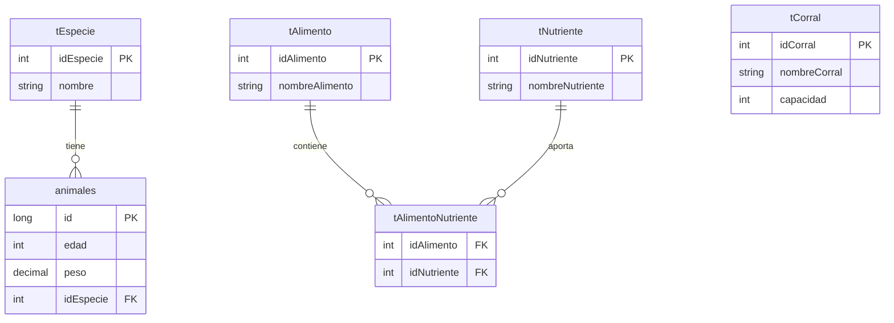

# Proyecto-Final-Sistemas-

## Descripción general del proyecto

Este proyecto consiste en el desarrollo de una API REST utilizando Java y el
framework Spring Boot para la materia de Implementación de Sistemas. El sistema
permite gestionar el catálogo de animales, alimentos, nutrientes y corrales de
una granja, resolviendo la problemática actual donde la información está
dispersa y no hay un control real sobre lo que se consume. A través de esta API,
se registran los animales con su respectiva especie, los alimentos disponibles,
los nutrientes que aporta cada uno y los corrales operativos. Esto sienta las
bases operativas para controlar la alimentación y gestión del ganado y, en una
etapa posterior, analizar qué dieta da mejores resultados sobre la producción y
beneficio que se obtiene de los animales.

## Integrantes del equipo

- Cruz Fuentes Vianidxi Ximena
- Ojeda Guevara Brandon Adiel
- Sanchez Rodríguez Monica

## Tabla de requerimientos

| ID | Nombre del requerimiento | Descripción del sistema | Herramienta / concepto |
|----|--------------------------|-------------------------|------------------------|
| REQ-01 | **Gestión de entidades (CRUD)** | El sistema debe exponer endpoints REST que permitan crear, leer, actualizar y eliminar registros de los catálogos de Animales, Especies, Alimentos, Nutrientes y Corrales. | Spring Web |
| REQ-02 | **Conexión a base de datos** | El sistema debe establecer una conexión con un motor de base de datos relacional para persistir la información y mapear las tablas a clases de Java. | Spring Data JPA |
| REQ-03 | **Validación de reglas de negocio** | El sistema debe verificar que los datos ingresados sean correctos antes de guardarlos, incluyendo que la edad y el peso del animal sean mayores a cero. | Spring Boot Validation |
| REQ-04 | **Documentación de la API** | El sistema debe generar una interfaz interactiva donde los desarrolladores puedan consultar y probar los endpoints. | Springdoc OpenAPI / Swagger |
| REQ-05 | **Registro de eventos (logs)** | El sistema debe registrar actividad en consola para monitorear peticiones, consultas SQL y errores o excepciones. | Spring Boot Logging / SLF4J |

## Funcionalidades de Spring Boot

- **Spring Data JPA:** facilita el mapeo relacional y la persistencia.
- **Spring Web:** permite construir endpoints REST.
- **Springdoc OpenAPI / Swagger:** genera documentación interactiva.
- **Spring Boot Validation:** valida los datos recibidos.
- **Spring Security:** protege las operaciones de escritura y permite autenticar usuarios.
- **SLF4J / Logback:** registra eventos y errores.

## Laboratorio Spring JPA: Animal

El laboratorio adapta el ejemplo de Spring JPA al dominio de la granja. `Animal`
tiene un repositorio basado en `JpaRepository` y un controlador con operaciones
CRUD. Cada animal pertenece a una especie; la edad y el peso deben ser mayores
que cero.

## Entorno de desarrollo

El repositorio incluye `.devcontainer/devcontainer.json`,
`.devcontainer/Dockerfile` y `.devcontainer/docker-compose.yml` para configurar
un entorno con Java 17, Maven y el puerto 8080. También incluye `.gitignore`.

Para iniciar Docker Compose desde la raíz:

```bash
docker compose -f .devcontainer/docker-compose.yml up --build
```

Para ejecutar las pruebas:

```bash
mvn test
```

## Rama del laboratorio

El laboratorio se trabaja en la rama `feature/Animal`. El equipo debe mantener
la rama principal `main` y utilizar ramas de trabajo y Pull Requests para
integrar los cambios.

## Ejecutar y probar

Inicia la aplicación:

```bash
mvn spring-boot:run
```

H2 se ejecuta en memoria y se reinicia al detener la aplicación. Consola:
<http://localhost:8080/h2-console>

- JDBC URL: `jdbc:h2:mem:granja`
- Usuario: `sa`
- Contraseña: vacía

Ejecuta las pruebas:

```bash
mvn test
```

## Autenticación JWT

Credenciales locales de desarrollo:

- Usuario: `admin`
- Contraseña: `admin123`

Obtén un token:

```bash
curl -X POST http://localhost:8080/api/auth/login \
  -H "Content-Type: application/json" \
  -d '{"username":"admin","password":"admin123"}'
```

La respuesta incluye `token`. Para operaciones protegidas, envíalo como Bearer:

```bash
curl -X POST http://localhost:8080/api/nutrientes \
  -H "Authorization: Bearer <TOKEN>" \
  -H "Content-Type: application/json" \
  -d '{"nombreNutriente":"Proteína"}'
```

Las operaciones GET son públicas. POST, PUT y DELETE requieren un JWT válido.
Puedes cambiar las credenciales mediante `APP_AUTH_USERNAME` y
`APP_AUTH_PASSWORD`. Cambia `JWT_SECRET` por una clave Base64 segura antes de
desplegar la aplicación.

## Swagger / OpenAPI

- Interfaz: <http://localhost:8080/swagger-ui.html>
- Especificación JSON: <http://localhost:8080/v3/api-docs>

Para probar una operación protegida:

1. Ejecuta `POST /api/auth/login` y copia el valor de `token`.
2. Pulsa **Authorize** en Swagger UI.
3. Pega el token y confirma.

## Endpoints

### Animales

- `GET /animales`
- `GET /animales/{id}`
- `POST /animales`
- `PUT /animales/{id}`
- `DELETE /animales/{id}`

Ejemplo de cuerpo para alta o actualización:

```json
{
  "especieId": 1,
  "edad": 3,
  "peso": 450.5
}
```

### Especies

- `GET /api/especies`
- `GET /api/especies/{id}`
- `POST /api/especies`
- `PUT /api/especies/{id}`
- `DELETE /api/especies/{id}`

### Alimentos

- `GET /api/alimentos`
- `GET /api/alimentos/{id}`
- `POST /api/alimentos`
- `PUT /api/alimentos/{id}`
- `DELETE /api/alimentos/{id}`

El cuerpo de alta o actualización acepta IDs de nutrientes:

```json
{
  "nombreAlimento": "Alfalfa",
  "nutrientesIds": [1, 2]
}
```

Omitir `nutrientesIds` o enviarlo como lista vacía deja el alimento sin nutrientes.

### Nutrientes

- `GET /api/nutrientes`
- `GET /api/nutrientes/{id}`
- `POST /api/nutrientes`
- `PUT /api/nutrientes/{id}`
- `DELETE /api/nutrientes/{id}`

### Corrales

`Corral` es un catálogo independiente: la tabla `tCorral` no contiene llaves
foráneas ni relaciones con otras entidades.

- `GET /api/corrales`
- `GET /api/corrales/{id}`
- `POST /api/corrales`
- `PUT /api/corrales/{id}`
- `DELETE /api/corrales/{id}`

Ejemplo para crear o actualizar un corral:

```json
{
  "nombreCorral": "Corral Norte",
  "capacidad": 25
}
```

Las operaciones `POST`, `PUT` y `DELETE` requieren un token JWT Bearer.

## Diagrama entidad-relación

La relación entre alimento y nutriente es N:M y se implementa mediante
`tAlimentoNutriente`. `tCorral` es un catálogo independiente, sin llaves
foráneas ni relaciones con las demás tablas.


